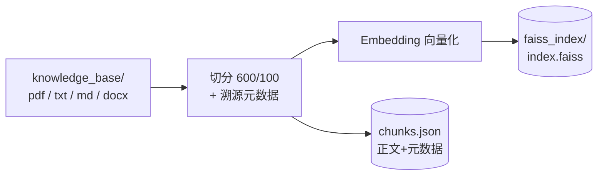
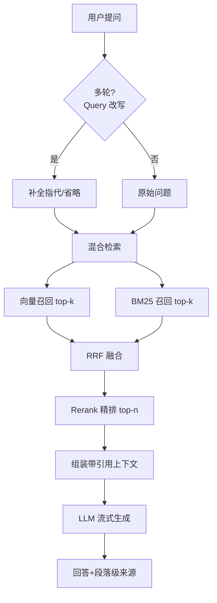

# 本地知识库智能问答助手（RAG + Agent 检索增强）

基于**检索增强生成（RAG）**的命令行知识库问答系统。相比基础版，本版本实现了**混合检索 + Rerank 精排**、**多轮 Query 改写与指代消解**、**段落级溯源**与**统一配置管理**，有效提升召回准确率与回答可解释性，缓解大模型幻觉问题。

## 功能特性

- **多格式文档支持**：PDF / TXT / Markdown / DOCX 一键扫描入库
- **混合检索**：BM25（关键词精确匹配）+ FAISS 向量（语义相似度）双路召回，RRF 倒数排名融合
- **Rerank 精排**：DashScope Rerank 模型对候选做交互编码重排序，失败自动降级，不阻断主链路
- **Query 改写 / 指代消解**：多轮对话中"它 / 这个 / 第二种"等追问自动补全为可独立检索的问题
- **段落级溯源**：回答中用 `[1][2]` 标注引用，末尾列出文件名、页码 / 段落号与相关度
- **流式输出**：打字机式逐字返回，交互体验接近在线产品
- **多轮对话**：保留最近 N 轮历史并按轮裁剪；历史只存原始问答，杜绝参考资料污染
- **统一配置管理**：pydantic-settings 集中管理全部参数，类型校验、.env 覆盖、开箱即用

## 系统架构

**离线索引构建**（`build_db.py`）：



**在线问答链路**（`chat_agent.py` + `retrieval.py`）：



## 技术栈

| 组件 | 选型 | 说明 |
| --- | --- | --- |
| LLM 编排框架 | LangChain 1.x | 模型初始化、文档加载、切分、向量检索封装 |
| 向量数据库 | FAISS（faiss-cpu） | 本地持久化、高性能相似度检索 |
| 关键词检索 | rank-bm25 + jieba | BM25 算法 + 中文分词 |
| Rerank 模型 | DashScope text-rerank | Cross-Encoder 交互编码精排 |
| 配置管理 | pydantic-settings | 类型校验 + 环境变量注入 |
| 大模型服务 | 通义千问（DashScope，OpenAI 兼容接口） | 对话生成 + Query 改写 + 向量化 |
| 语言 | Python 3.10+ | Windows / Linux 均可运行 |

## 快速开始

### 1. 环境准备

```bash
git clone <your-repo-url>
cd <your-repo-dir>

python -m venv .venv
source .venv/bin/activate        # Windows: .venv\Scripts\activate

pip install -r requirements.txt
```

### 2. 配置 API Key

在项目根目录放置 `.env` 文件：

```dotenv
DASHSCOPE_API_KEY=sk-你的密钥
DASHSCOPE_BASE_URL=https://dashscope.aliyuncs.com/compatible-mode/v1
```

> `.env` 已被 `.gitignore` 排除，密钥不会进入版本库。其余参数（模型名、Top-K、路径等）均有合理默认值，可选配置；如需覆盖，在 `.env` 中添加同名环境变量即可（见下方参数表）。

### 3. 构建知识库索引

将知识文档放入 `knowledge_base/` 目录（支持 `.pdf` `.txt` `.md` `.docx`），然后执行：

```bash
python build_db.py
```

索引将持久化到 `faiss_index/` 目录，包含 `index.faiss`（向量索引）与 `chunks.json`（正文 + 元数据，供 BM25 与溯源使用）。

### 4. 启动对话

```bash
python chat_agent.py
```

## 使用示例

```text
知识库对话助手已启动（混合检索 + Rerank + 流式输出），输入 quit 退出。

你：目前主流的开源模型体系有哪些？
助手：目前主流的开源模型体系主要有三种：
1. Prefix Decoder 系：...代表 ChatGLM [1]
2. Causal Decoder 系：...代表 LLaMA [1]
3. Encoder-Decoder：...代表 T5、BART [1]

参考来源：
  [1] 1-大模型（LLMs）基础面.docx · 无页码 · 第1段 · 相关度 1.0
  [2] 1-大模型（LLMs）基础面.docx · 无页码 · 第2段 · 相关度 0.41

你：它有哪些特点？        ← 指代消解：自动补全为"上述三种开源模型体系有哪些特点"
助手：...

你：quit
```

## 项目结构

```text
.
├── config.py            # 统一配置管理（pydantic-settings）+ 提示词
├── build_db.py          # 离线索引：加载 → 切分 → 增强元数据 → 向量化 → 落盘
├── retrieval.py         # 混合检索：BM25 + 向量 → RRF 融合 → Rerank 精排
├── chat_agent.py        # 在线问答：Query 改写 → 检索 → 带引用上下文 → 流式生成
├── knowledge_base/      # 知识文档（pdf / txt / md / docx）
├── faiss_index/         # 索引产物（不入版本库）
│   ├── index.faiss / index.pkl
│   └── chunks.json      # chunk 正文 + 溯源元数据
├── .env                 # 环境变量（API Key 等，不入版本库）
└── requirements.txt     # 依赖清单
```

## 关键设计与可调参数

### 为什么这样设计

- **混合检索**：向量擅长语义相近但字面不同的查询，BM25 擅长专有名词 / 数字 / 精确词（如模型名 `ChatGLM`），二者互补；**RRF** 按名次融合，无需对不同来源的分数做归一化，对各路分数分布无假设。
- **Rerank**：双路召回是"粗排"，召回广但精度低；Rerank 把 query 与 doc 拼接做交互编码，精度高，只对少量候选重排，成本可控。API 异常时降级为融合顺序，保证可用。
- **Query 改写**：多轮对话中用户常用指代词提问，直接检索会失败；用 LLM 结合最近几轮历史把追问补成独立问题，**只用于检索**，不污染原始提问与历史。
- **历史污染修复**：旧实现把"参考资料 + 问题"写入对话历史，导致历史雪球式膨胀且模型误读旧资料；本版历史仅存原始问答，资料按轮临时注入。
- **溯源**：chunk 在切分阶段即写入文件名 / 页码 / 段号 / 字符位置，回答时按引用编号定位到段落，可解释、可核查。

### 参数表（均在 `config.py`，可用 .env 覆盖）

| 参数 | 默认值 | 说明 |
| --- | --- | --- |
| `CHAT_MODEL` | `qwen3.8-flash` | 对话 / Query 改写模型（兼容旧名 `MODEL_NAME`）|
| `EMBEDDING_MODEL` | `qwen3.7-text-embedding-flash` | 向量化模型（1024 维）|
| `RERANK_MODEL` | `qwen3.7-text-rerank` | Rerank 精排模型 |
| `RETRIEVE_TOP_K` | `20` | 每路召回条数 |
| `FINAL_TOP_K` | `4` | 精排后送入 LLM 的条数 |
| `RRF_K` | `60` | RRF 融合常数，抑制头部排名过度加权 |
| `MAX_TURNS` | `10` | 保留的对话轮数 |
| `TEMPERATURE` | `0.1` | 生成温度 |
| `ENABLE_HYBRID` | `true` | 混合检索开关（消融实验用）|
| `ENABLE_RERANK` | `true` | Rerank 开关（消融实验用）|
| `ENABLE_QUERY_REWRITE` | `true` | Query 改写开关（消融实验用）|

> 通过开关注闭某模块即可做**消融实验**，对比各组件对回答质量的贡献。

## Roadmap

- [x] 多轮指代消解与 Query 改写
- [x] 混合检索（BM25 + 向量）与 Rerank 重排序
- [x] 元数据与段落级溯源
- [x] 统一配置管理（pydantic-settings）
- [ ] Function Calling 工具调用，升级为具备任务规划能力的 Agent
- [ ] 检索质量评估集（Recall@K / 答案忠实度）
- [ ] Web UI（Streamlit）与多会话管理
